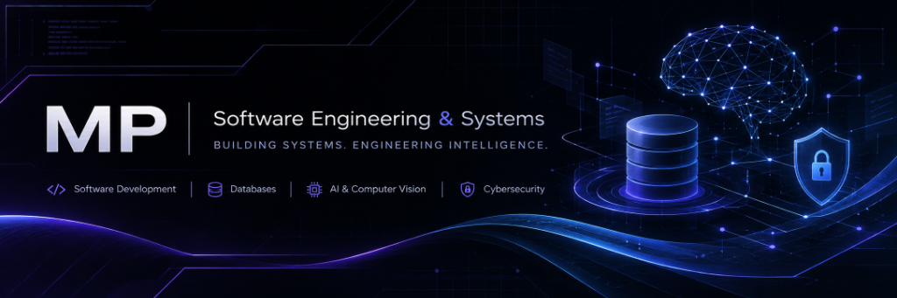
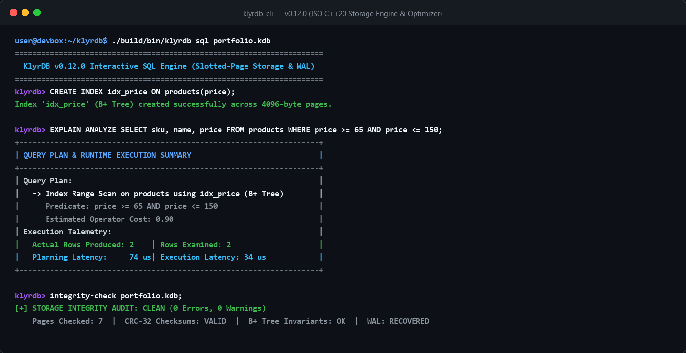
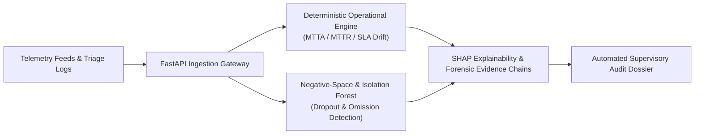
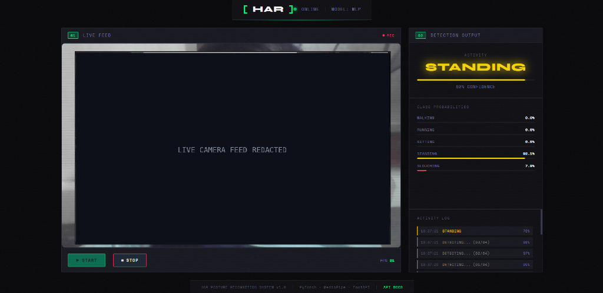
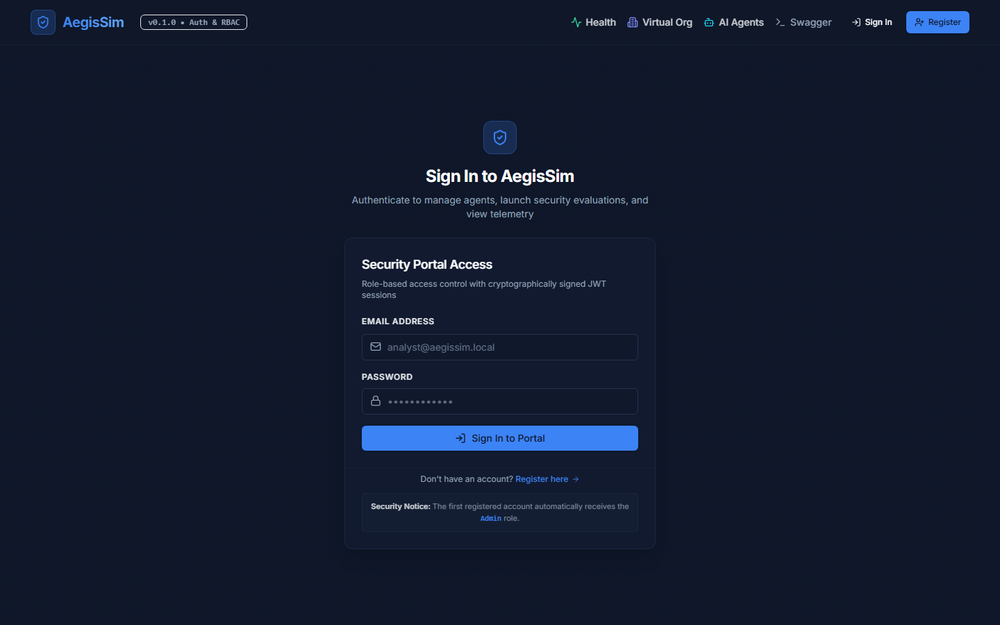

  

# MP (Meet Patil)

**Computer Engineering Student | Systems Engineering | Full-Stack Development | Applied AI & Cybersecurity**

I am a Computer Engineering student focused on engineering complete, resilient software systems from first principles. My work centers on database internals and systems programming in modern C++, full-stack web platforms, deterministic security evaluation for autonomous AI agents, and real-time computer vision pipelines. I prioritize software reliability, clean systems architecture, and deep technical understanding over surface-level abstractions.

---

## Engineering Interests

- **Systems Engineering:** Database internals, slotted-page storage architectures, persistent B+ tree indexing, buffer pool cache eviction, and ARIES-style write-ahead logging (WAL) crash recovery.
- **Full-Stack Development:** Production web platforms, modular REST API services, stateless JWT session authentication, relational and document schema design, and responsive user interfaces.
- **Applied AI & Computer Vision:** Real-time monocular pose estimation, temporal sequence modeling via sliding FIFO windows, neural network classification, and biomechanical ergonomics analysis.
- **Cybersecurity Engineering:** Deterministic zero-LLM policy enforcement points (PEP), tamper-evident cryptographic event ledgers, security telemetry correlation, and supervisory SOC analytics.

---

## Tech Stack

### Programming Languages

### Web & Backend

### Databases

### AI & Computer Vision

### Systems & Developer Tools

---

## Featured Projects

### 1. KlyrDB — Embedded SQL Relational Database Engine

> A persistent, embedded SQL relational database engine implemented from scratch in standard ISO C++20.

- **Problem Addressed:** Relational database engines are frequently treated as black boxes. KlyrDB was engineered from the storage layer up to study, implement, and benchmark classical database internals—slotted-page layouts, indexing invariants, cost-based optimization, and transaction durability.
- **Core Engineering Features:**
  - **Page Storage Engine:** Implements fixed 4096-byte pages with 24-byte binary headers, slot directory array indirection, Free-Space Map (FSM) capacity tracking, and IEEE 802.3 CRC-32 integrity validation.
  - **B+ Tree Indexing:** Persistent on-disk B+ tree index supporting point lookups, duplicate-key handling, and split/merge page balancing.
  - **SQL Engine & Cost Planner:** Recursive-descent parser generating an Abstract Syntax Tree (AST), coupled with a cost-based query optimizer that selects between sequential table scans and index range scans with `EXPLAIN` and `EXPLAIN ANALYZE` execution profiling.
  - **Durability & Crash Recovery:** Write-Ahead Logging (WAL) with monotonic Log Sequence Numbers (LSN), transaction state machine (`BEGIN`, `COMMIT`, `ROLLBACK`), safe checkpoint boundaries, and ARIES-style 3-pass crash recovery.
  - **Storage Auditing & Diagnostics:** Built-in `integrity-check` subsystem validating page headers, pointer consistency, and relational constraints, alongside physical snapshot backup with atomic restore.
- **Technology Stack:** ISO C++20, CMake, CTest
- **Development Status:** v0.12.0 Release Candidate
- **Repository:** [github.com/mnp210/Klyr-DB ↗](https://github.com/mnp210/Klyr-DB)

  

---

### 2. SAT-SA — Supervisory Analytics Tool for SOC Assessment

> An AI-driven supervisory assurance platform engineered to monitor Security Operations Center (SOC) operational performance, triage omission patterns, and incident lifecycles.

- **Problem Addressed:** Traditional SIEM and SOAR solutions monitor IT network infrastructure for external threats, but lack mechanisms to audit the SOC itself. When telemetry sensors fail or triage fatigue leads to rapid alert dismissal, absence of alerts is dangerously conflated with absence of malicious activity.
- **Core Engineering Features:**
  - **Objective Supervisory Layer:** Ingests triage timelines, case resolutions, and escalation lifecycles directly from case-management systems to audit analyst tradecraft independently of SIEM alerting rules.
  - **Negative-Space Detection:** Algorithmic detectors identifying missing expected operational events—such as silent sensor telemetry dropouts, uninvestigated high-severity alerts, and investigation playbook omissions.
  - **Deterministic Metrics Engine:** Precision calculation of Mean Time to Acknowledge (MTTA), Mean Time to Investigate (MTTI), Mean Time to Resolve (MTTR), rapid-closure outlier ratios, and SLA breach probabilities.
  - **Unsupervised Anomaly Scoring:** 14-dimensional feature extraction evaluating case handling patterns using calibrated Isolation Forest anomaly scoring.
  - **Explainability & Forensic Evidence:** Integration of TreeExplainer SHAP values providing mathematical attribution for flagged operational anomalies, tied to immutable relational evidence chains.
- **Technology Stack:** Python, FastAPI, PostgreSQL, SQLAlchemy, scikit-learn, Docker
- **Development Status:** Core Analytics & Ingestion Verified; Active Research Prototype

---

### 3. Arcadia — Game Discovery & Storefront Platform

> A full-stack video game discovery and catalog web platform unifying titles across major gaming ecosystems with structured metadata, community reviews, and verified outbound retailer routing.

- **Problem Addressed:** PC and console gamers face fragmented digital storefronts (Steam, PlayStation Store, Xbox, Nintendo eShop, GOG) with inconsistent metadata, disjointed reviews, and separate libraries. Arcadia unifies cross-platform catalog exploration into a single web experience.
- **Core Engineering Features:**
  - **Multi-Platform Catalog Aggregation:** Integrated upstream proxying to the RAWG Video Games Database API, featuring local MongoDB caching, Metacritic benchmark scoring, genre filtering, and bounded pagination.
  - **Data Isolation & Collection Tracking:** Personal libraries tracking ownership progress across four distinct states (*Playing*, *Completed*, *Backlog*, *Dropped*) with platform tagging, strictly decoupled from user wishlists.
  - **Authentication & Security:** Stateless JSON Web Token (JWT) authentication, bcrypt password hashing with 12 computational rounds, strict CORS origin allowlisting, and double-submit Anti-CSRF protection tokens.
  - **Administrative Control Plane (`/admin`):** Role-based moderation console supporting catalog curation, user account management, and real-time MongoDB operational telemetry.
  - **Verified Storefront Redirection:** Sanitized outbound routing restricted to authorized digital retailers, preventing open-redirect vulnerabilities.
- **Technology Stack:** React, Node.js, Express.js, MongoDB, REST APIs
- **Deployments & Links:** [Live Platform ↗](https://arcadia-two-ruby.vercel.app/) | [Showcase Repository ↗](https://github.com/mnp210/Arcadia-showcase) *(Source repository is private)*

  

---

### 4. HAR Posture Recognition — Real-Time Postural Ergonomics System

> A monocular computer vision application for real-time human activity recognition and postural ergonomics assessment operating from standard webcam streams.

- **Problem Addressed:** Prolonged sedentary workstation use causes musculoskeletal strain, yet traditional activity recognition systems rely on body-worn gyroscopes or wearable sensors that suffer from battery limits and high friction.
- **Core Engineering Features:**
  - **3D Pose Landmark Extraction:** Processes live webcam frames through MediaPipe Pose tracking, capturing 33 spatial skeletal coordinates normalized relative to torso dimensions to maintain camera-distance invariance.
  - **Temporal Sequence Buffer:** Implements a First-In-First-Out (FIFO) sliding window of $T=64$ consecutive frames ($\approx 2.1$ seconds at 30 FPS) to capture dynamic movement kinetics, avoiding single-frame posture ambiguities.
  - **Deep Neural Classification:** PyTorch Multi-Layer Perceptron (MLP) neural classifier ($512 \to 256 \to 128 \to \text{Softmax}$) categorizing motion into five classes (*Walking*, *Running*, *Standing*, *Sitting*, *Slouching*).
  - **Biomechanical Safety Guard:** Procedural rule engine evaluating thoracic spine curvature, head tilt angles, and knee flexion to flag active ergonomic hazards.
  - **Low-Latency Inference:** Achieves sub-millisecond inference latency ($0.287\text{ ms}$ on commodity CPU), enabling real-time telemetry overlays and instant HUD posture alerts.
- **Technology Stack:** Python, PyTorch, MediaPipe, OpenCV, FastAPI
- **Development Status:** Architecture Specification & Evaluation Report Published
- **Repository:** [github.com/mnp210/HAR-Posture-Recognition ↗](https://github.com/mnp210/HAR-Posture-Recognition)

  

---

### 5. AegisSim — Autonomous AI Agent Security Evaluation & Sandboxing

> A cybersecurity evaluation and sandboxing platform engineered to benchmark autonomous AI agents against prompt injection, privilege escalation, and tool misuse within an isolated enterprise environment.

- **Problem Addressed:** Tool-augmented AI agents granted access to internal databases, execution shells, and communication APIs introduce severe attack surfaces. Relying on an "LLM-as-a-judge" to police agent safety introduces non-deterministic verdicts and hallucinations.
- **Core Engineering Features:**
  - **Deterministic Policy Enforcement Point (PEP):** Intercepts proposed tool calls at runtime, applying zero-LLM procedural checks: Pydantic schema validation, exact-match agent whitelisting, regex canary screening, and AST-level destructive SQL filtering.
  - **4-Tier Data Clearance Model:** Enforces granular sensitivity levels (`PUBLIC`, `INTERNAL`, `CONFIDENTIAL`, `RESTRICTED`) ensuring agents cannot inspect assets above their assigned privilege.
  - **Human-in-the-Loop (HITL) Queue:** Automatically suspends simulation runs upon detecting high-risk operations (such as data export or network egress), generating payload snapshots requiring explicit analyst approval.
  - **Tamper-Evident Event Ledger:** Records every simulation step in a cryptographically chained SHA-256 block ledger with mathematical forward-integrity verification (`verify_run_chain`) and append-only HTTP 405 enforcement.
  - **Synthetic Enterprise Sandbox:** Simulates enterprise departments, employee records, and active canary honeytokens with zero exposure of real-world PII.
- **Technology Stack:** Python, FastAPI, PostgreSQL, Next.js, Docker
- **Development Status:** Architecture Specification & Testing Framework Complete
- **Public Showcase:** [github.com/mnp210/AegisSim-showcase ↗](https://github.com/mnp210/AegisSim-showcase) *(Core simulation engine remains private intellectual property)*

  

---

## Currently Exploring

- **Database Internals & Storage Systems:** Lock-free concurrency control, Multi-Version Concurrency Control (MVCC), and distributed consensus replication (Raft).
- **Reliable Software Architecture:** Event-driven backend design, distributed tracing, and formal verification of critical software invariants.
- **Applied AI & Machine Learning:** Edge device inference optimization, lightweight model quantization, and reproducible evaluation benchmarks.
- **Cybersecurity Engineering:** Deterministic isolation boundaries, container escape defenses, and vulnerability modeling in multi-agent autonomous ecosystems.
- **Software Testing & Performance:** Fuzz testing, automated property testing with Hypothesis, and CPU cache-locality profiling.

---

## Contact

- **GitHub:** [github.com/mnp210](https://github.com/mnp210)
- **LinkedIn:** [linkedin.com/in/meet-patil-068920430](https://www.linkedin.com/in/meet-patil-068920430/)
- **Email:** [mnpwizard@gmail.com](mailto:mnpwizard@gmail.com)

---

  <em>Building things, understanding how they work, and making them better.</em>

